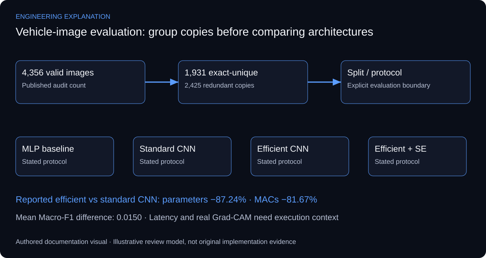

# Efficient Neural Network Architectures for Vehicle Type Classification

## Reporting efficiency without hiding evaluation assumptions

The public research compares an MLP, a standard CNN, a depthwise-separable efficient CNN and an efficient CNN with Squeeze-and-Excitation. The reported efficient-CNN comparison gives 87.24% fewer parameters, 81.67% fewer MACs and a mean Macro-F1 difference of 0.0150. These are existing public summary values, not new training results.

The data audit reports 4,356 valid images and 1,931 exact-unique images after 2,425 redundant copies are identified. An image-level split can place identical content on both sides of an evaluation boundary. A defensible explanation therefore puts duplicate grouping and split identity before architecture comparison. Protocol changes in data composition and training settings also mean a conventional-versus-controlled gap is not a causal estimate of leakage.

Parameter count, MACs and measured latency describe different costs. Reduced arithmetic does not guarantee the same latency improvement on every device; batch size, input shape, precision, warm-up and the execution environment affect a timing measurement. The available public figures do not establish a deployment benchmark or an absolute latency number.

Grad-CAM provides a class-related visual explanation, not proof that a prediction is causally correct. A useful figure would show input, predicted/true class and heatmap together, with attention to vehicle regions and letterbox padding. The assessment notebook, training curves, classwise confusion matrices and actual Grad-CAM panels remain private. No generated heatmap is substituted for an executed model output.

*New explanatory responsibilities and review criteria; not an as-built drawing or new test result.*

## Review scenarios and expected evidence

These are review criteria, not additional completed tests.

| Review area | Method | Evidence to inspect |
|---|---|---|
| Data integrity | Review duplicate groups and split identity | No identical content crossing the stated boundary |
| Classification | Review classwise and Macro-F1 results | Protocol, class support and uncertainty context |
| Efficiency | Separate parameters/MACs from measured latency | Input shape and execution environment stated |
| Explainability | Inspect real model-generated attention | Input, class and preprocessing shown together |

## Primary technical references

- [Grad-CAM — original research paper](https://arxiv.org/abs/1610.02391)

References support the explanation, not undocumented implementation claims.

Only already-public aggregate research claims are expanded here. Private assessment artifacts are not released.

[Published case study](https://mahyoub88.github.io/projects/proj-vtid2/).
